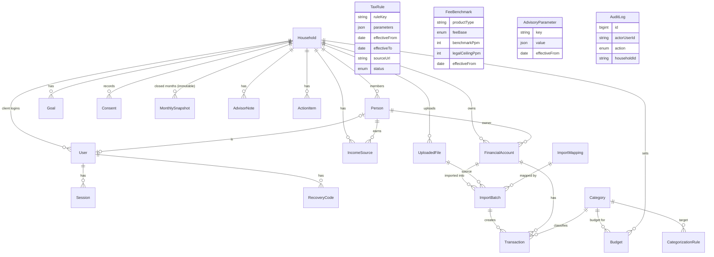

# ER diagram

Solid = implemented in Phase 0 (`prisma/schema.prisma`). The "Planned" section is the design for later phases. It is added in its phase so we don't migrate speculative columns.

## Planned (by phase)

**Phase 1** — no new tables. It uses Transaction, ImportBatch, ImportMapping, CategorizationRule (learned rules), Budget, MonthlySnapshot.payload (category breakdown, budget vs actual, calc version), AdvisorNote and ActionItem. It adds `RecurringCharge` (detected subscriptions and installment plans).

**Phase 2 — Module C (implemented)**: `FinancialAccount` details, `BalanceSnapshot`, `LongTermProduct`, `ProductBalance`, `RetirementAssumptions`. Original design notes:
- `FinancialAccount` + overdraft limit, overdraft interest paid, monthly fees (bank). For cards: billing day, credit plan.
- `BalanceSnapshot` (account, date, balance agorot) for net worth.
- `LongTermProduct` (pension / provident / study fund / managers' insurance / insurance): provider, type, track, balance, monthly deposit, `feeDepositsPpm`, `feeAccumulationPpm`, start date, employer/employee split.
- `ProductStatement` (imported clearinghouse report rows, pluggable parser).
- `RetirementScenario` (advisor-editable inputs: conservative / base / optimistic).

**Phase 3 — Module D**
- `TaxRule.parameters` JSON schemas per key. `CpiValue` (month, index) for real gains and inflationary amounts.
- `Property` (purchase price/date/costs, improvements, rent, mortgage link).
- `SecurityHolding`, `SecurityLot`, `PortfolioCashflow` (for TWR/MWR), `RealizedGain`, `LossCarryForward`.
- `DepositOrMoneyMarket` (balance, yield ppm, fees).
- `CalculationRun` (inputs, rule ids/versions used, steps, result) for tax traceability.

**Phase 4 — Module E/F**
- `Mortgage` → `MortgageTrack` (indexed?, fixed/variable, rate ppm, balance, term, remaining months). `Loan` (consumer loans, overdraft, card credit).
- `Recommendation` (rule id, reason, impact agorot monthly/lifetime, status PROPOSED/APPROVED/IN_PROGRESS/DONE, order, visibleToClient only when approved).
- `Report` (type, period, locale, file key, generated by).
